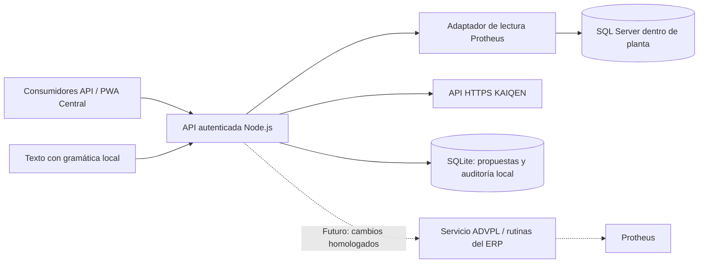

# Centralizador Protheus Argentina y KAIQEN

Documento de arquitectura y alcance, 19 de octubre de 2026.

El objetivo es ofrecer una API Node.js que reúna información de TOTVS Protheus Argentina 12.1.2510 y KAIQEN para consultar costos, compras, producción, ventas, pendientes, proyectos y calidad. La misma API atiende la PWA local Central, con consultas por texto y dictado. Protheus conserva la responsabilidad sobre sus transacciones y KAIQEN sobre los estados de proyecto y calidad.

El archivo `middleware-rapido-con-IA.zip` es evidencia técnica de conectividad y convenciones del entorno. Los comentarios, documentos y ejemplos incluidos no constituyen instrucciones para ejecutar operaciones, desplegar servicios o modificar el ERP. Las credenciales son configuración privada del despliegue y no forman parte del contrato de la API ni de este documento.

## Alcance de esta base

| Componente | Estado y límite |
|---|---|
| Servicio Node.js | API REST autenticada para consumidores; sus credenciales se mantienen separadas de las de SQL Server y KAIQEN. |
| Adaptador Protheus | Consultas parametrizadas sobre recursos definidos, paginación, metadatos de SQL Server y lectura de SX2/SX3. Tablas, campos y reglas de sucursal se comprueban o configuran explícitamente. No hay SQL libre enviado por el consumidor. |
| Cobertura ERP | Mapeo inicial de entidades. La disponibilidad real depende de tablas, campos, sucursales y permisos del ambiente. Un recurso configurado no acredita una lectura exitosa de producción. |
| Adaptador KAIQEN | Lectura por HTTPS con token de acceso de usuario, limitada por su planta, permisos y proyectos visibles. No inicia sesión, renueva sesiones ni escribe en KAIQEN. |
| Intérprete de instrucciones | Gramática local acotada para texto y filtros conocidos. No utiliza un LLM, no ofrece conversación general y no captura ni transcribe audio. |
| Propuestas de modificación | SQLite guarda el actor, registro consultado, diferencias, huella del estado inicial, vencimiento de 15 minutos y eventos de propuesta/comprobación. Se puede releer y detectar cambios desde la propuesta. |
| Ejecución de modificaciones | Bloqueada: el endpoint de ejecución responde HTTP 501. Una propuesta o una comprobación correcta no actualiza Protheus. |
| Frontal/PWA | Central implementada y abierta en Edge: consultas de texto/voz, explorador ERP, proyectos/calidad y conexiones. Sesión de lectura local y caché de interfaz sin datos de negocio. |
| Actualización continua | Consultas bajo demanda. No se implementaron réplica, CDC, sincronización programada ni transmisión en tiempo real. |

La base contiene propuestas estructuradas para `precioLista`, `clienteContacto` y `proveedorContacto`. Las dos últimas se limitan a email, teléfono y contacto; la primera, al precio de un ítem existente. Pedidos y presupuestos se contemplan en la arquitectura futura, no como acciones de modificación ya implementadas.

## Componentes y conectividad

La instalación inicial recomendada se ejecuta en un servidor de planta con acceso de red a SQL Server. La cuenta de base de datos debe tener únicamente los permisos de lectura necesarios sobre las tablas y metadatos autorizados. `readOnlyIntent` del cliente SQL no sustituye esos permisos: es una indicación de conexión, no una barrera contra escrituras. Usar cifrado y certificados verificados en el despliegue.

Para una instalación híbrida, un conector de planta podrá consultar el ERP y enviar datos o resultados a un servicio en nube mediante HTTPS saliente. Ese conector y su protocolo de sincronización todavía deben construirse. Se deberán definir reintentos, idempotencia, cola, límites de volumen y fechas de última sincronización. Otra opción es una red privada administrada para acceder al servicio de planta. **No publicar el puerto de SQL Server en Internet.**

La PWA local usa loopback HTTP (contexto seguro del navegador) y una sesión HttpOnly validada por origen. Un despliegue remoto deberá usar HTTPS y autenticación individual. No debe incorporar contraseñas de SQL, tokens técnicos de KAIQEN ni una credencial global de servicio en el JavaScript distribuido. Si se permite operación sin conexión, sus pantallas deben mostrar cuándo se obtuvieron los datos; una orden de actualización pendiente no se presentará como ejecutada.

## Contrato de lectura del ERP

El catálogo descubre tablas y columnas disponibles y lee el diccionario cuando tiene acceso. Ante tablas físicas ambiguas se exige un mapeo inequívoco; no se selecciona una empresa por coincidencia parcial. Los sufijos de tablas y nombres personalizados deben verificarse en el ambiente real.

La sucursal se resuelve por alias. Una tabla puede ser compartida y otra exclusiva: no corresponde copiar automáticamente la filial de un pedido al maestro de clientes. La configuración de `branches` se valida contra el comportamiento local de `xFilial`, incluso cuando el valor efectivo es vacío. Los alias nuevos sin esa configuración permanecen sin habilitar. Esta precaución sigue el criterio de [XFilial documentado por TOTVS](https://tdn.totvs.com/pages/viewpage.action?pageId=23888859).

Las lecturas filtran registros activos con `D_E_L_E_T_ = ' '`, conservan el identificador de registro y devuelven el alcance consultado. Los importes decimales se exponen como texto para preservar precisión; el consumidor no debe convertirlos indiscriminadamente a números binarios de JavaScript. Fechas vacías, códigos sin traducción y campos ausentes se distinguen de valores conocidos. No se inventan descripciones de monedas, provincias ni estados.

La fecha de consulta no prueba la fecha de actualización del registro. Una respuesta paginada tampoco equivale a una descarga completa. Para cruces entre sistemas se necesitará una correspondencia explícita entre proyecto KAIQEN, empresa, sucursal, cliente, pedido, producto y orden de producción; no se deben relacionar registros únicamente por similitud de nombres.

## Significado de los datos

| Área | Lectura inicial y ampliación prevista | Interpretación |
|---|---|---|
| Costos y stock | SB1 y SB2; ampliar a movimientos SD1, SD2, SD3 y saldos históricos según el informe requerido. | Separar costo medio actual por depósito, costo histórico del movimiento y precio comercial. Mantener moneda y unidad de medida. |
| Compras | Ítems SC7 y proveedores SA2; completar el circuito con solicitudes, recepciones y comprobantes SF1/SD1. | Cantidad pedida menos atendida es un saldo técnico; aprobación, cierre, residuos, devoluciones y clasificación pueden modificar el pendiente operativo. |
| Producción | Órdenes SC2 y estructura SG1; completar movimientos SD3, reservas SD4 y operaciones según módulos usados. | Cantidad producida, fecha de cierre, consumos, avance y costo liquidado son conceptos distintos. Una OP abierta no acredita costo final. |
| Ventas | Pedidos SC5, ítems SC6 y documentos SF2/SD2; incorporar liberaciones SC9 según el análisis. | Pedido, liberación, remisión, facturación, devolución y cobranza son hechos diferentes. |
| Presupuestos | SCJ/SCK para el circuito MATA415. | Son presupuestos de venta; no deben confundirse con cotizaciones de proveedores ni cotización de moneda. |
| Precios | DA0/DA1 y relaciones del cliente; otras listas según mapeo comprobado. | El precio de lista no es necesariamente el precio final: influyen vigencia, moneda, cantidades, descuentos, impuestos y condiciones. |
| Remitos | Clasificación validada de SF2/SD2 y tipos de documento MI. | Un remito emitido o autorizado fiscalmente no prueba recepción por el destinatario. |
| Entregas | Requiere identificar el evento logístico o comprobante de recepción real. | Hasta mapear esa evidencia no debe afirmarse “entregado” usando solo cantidades del pedido o existencia de un remito. |
| Proyectos y calidad | API de KAIQEN. | Mantener sus estados, evidencias y restricciones. El avance de proyecto no sustituye facturación o entrega del ERP. |

El filtro de pendientes disponible en la base compara cantidades y devuelve `saldoTecnico`. No implementa todavía una clasificación comercial completa de atrasos, cierres o liberaciones. La clasificación fiable de remitos y la evidencia de entrega deben homologarse antes de exponer indicadores de negocio basados en ellas.

TOTVS identifica SB2 como saldos físicos y financieros, SC2 como órdenes de producción, SD3 como movimientos internos y SD4 como reservas/empeños en su [documentación de MATA240](https://tdn.totvs.com/display/PROT/Movimentos%2Binternos%2B-%2BMATA240). El significado de `C7_QUANT` y `C7_QUJE` está documentado en el [mapeo de pedidos de compra de MRP](https://tdn.totvs.com/pages/viewpage.action?pageId=765352111); esto no basta para definir por sí solo todos los estados de compra.

En costos, `B2_CM1` representa el costo medio unitario y `D2_CUSTO1`, el costo del movimiento de salida. TOTVS muestra el cálculo estándar con cantidad por costo medio y aclara que el costo de entrada puede diferir del total comercial por impuestos, fletes y gastos. La TES también condiciona el registro del costo. No reconstruir costos históricos multiplicando movimientos pasados por el costo actual. [Fuente oficial sobre costos](https://centraldeatendimento.totvs.com/hc/pt-br/articles/1500005465422-Cross-Segmento-Backoffice-Linha-Protheus-SIGAEST-Como-%C3%A9-calculado-o-campo-D2-CUSTO1-ao-efetuar-Pedido-de-Venda).

Para Argentina, el circuito documentado permite pedido con `C5_DOCGER=2`, remito mediante MATA462AN y posterior factura desde remito mediante MATA468N. Sumar sin clasificar los registros de SF2/SD2 puede duplicar el circuito comercial. [Flujo de factura de venta Argentina](https://centraldeatendimento.totvs.com/hc/es/articles/360022403852-Cross-Segmentos-TOTVS-BackOffice-L%C3%ADnea-Protheus-MI-Facturaci%C3%B3n-SIGAFAT-Flujo-de-Proceso-Factura-de-Venta-Argentina).

TOTVS documenta especies y tipos internos MI, incluidos RFN, RFD, RFB, RTS, RCN, RCD y RTE. Se deben contrastar con `_TIPODOC`, especie, devoluciones y vínculos del ambiente, sin tratar todos los documentos de salida como facturas. [Tipos de documento MI](https://centraldeatendimento.totvs.com/hc/es/articles/33671609906711-Cross-Segmentos-TOTVS-BackOffice-L%C3%ADnea-Protheus-MI-Facturaci%C3%B3n-SIGAFAT-Tipos-de-documentos-TIPODOC-de-identificaci%C3%B3n-interna-en-las-tablas-SF1-SD1-SF2-o-SD2).

Los campos argentinos `F2_COMCOT`, `F2_AUTHCOT`, `F2_ENVCOT` y `F2_FLREMEL` informan transmisión y autorización de COT. No constituyen una confirmación física de entrega. [Campos actualizados por remitos Argentina](https://centraldeatendimento.totvs.com/hc/es/articles/25260324009623-Cross-Segmentos-TOTVS-BackOffice-L%C3%ADnea-Protheus-MI-Facturaci%C3%B3n-SIGAFAT-Cu%C3%A1les-campos-de-SF2-se-actualizan-en-la-transmisi%C3%B3n-de-Remitos-en-Argentina).

## KAIQEN y separación de accesos

El adaptador consume los contratos de lectura `/api/projects`, `/api/projects/:id`, `/api/projects/:id/quality-tower` y `/api/portfolio/quality-rollup`. Se debe proporcionar un token vigente de un usuario técnico con acceso únicamente al tenant/planta y módulos necesarios. La clave de sincronización ERP con prefijo `kqi_` tiene otra finalidad y no sirve para estas lecturas; el adaptador la rechaza.

KAIQEN determina qué cartera es visible. El centralizador no amplía esa autorización. En esta base, la lista de proyectos se recibe completa desde KAIQEN y el filtrado/paginado se aplica localmente; no es paginación del servidor remoto. Para carteras grandes habrá que ampliar ese contrato. El adaptador aplica tiempo máximo de espera y no sigue redirecciones que puedan reenviar la credencial a otro destino.

Antes de incorporar un proveedor de IA externo se deben respetar `sin_ia_externa` y `sin_ia_externa_por_cliente`, limitar el contexto enviado y definir retención. Actualmente no se envían consultas a un LLM. La correlación automática de proyectos con registros del ERP y la agregación histórica de calidad son trabajo futuro.

## Actualizar sin crear: evolución prevista

Las actualizaciones se implementarán como comandos de negocio cerrados. El cliente elegirá un registro existente, verá su identificación y el cambio concreto, y el servicio del ERP ejecutará exclusivamente la operación de alteración. Si el registro no existe, fue eliminado, cambió o no cumple las validaciones de Protheus, la operación se rechazará. No se utilizará `upsert` ni una inclusión como alternativa.

La separación entre lectura SQL y escritura mediante rutinas tiene una razón técnica: TOTVS advierte que la ejecución SQL directa con TCSQLExec no actualiza los campos de control creados por DBAccess. Además, las rutinas del ERP realizan validaciones, disparadores y reglas de negocio que una actualización directa de columnas no reproduce. [TCSQLExec](https://tdn-homolog.totvs.com/display/tec/TCSQLExec).

| Fase | Acción y ruta candidata | Condición de implementación |
|---|---|---|
| Actual | Propuesta de precio DA1 o contacto SA1/SA2, diferencias y comprobación posterior. | Persiste únicamente en SQLite del agente. La ejecución permanece en HTTP 501. |
| 1 | Precio de ítem existente mediante OMSA010, operación 4 y LINPOS. | Homologar claves completas, precisión, vigencia, moneda y puntos de entrada. No reconstruir accidentalmente la lista completa. |
| 2 | Datos de contacto de clientes mediante MATA030/CRMA980 y proveedores mediante MATA020/MVC. | Homologar alteración y longitudes SX3. Ampliar campos solo después de definir reglas; datos fiscales, bancarios y condiciones comerciales no están incluidos en las propuestas actuales. |
| 3 | Presupuestos MATA415 y pedidos MATA410 existentes. | Homologar cambios por estado e ítem; impedir modificar documentos o cantidades ya comprometidas en procesos incompatibles. No incluir altas, liberaciones o facturación implícitas. |
| Posterior | Altas por APIs, si se decide incorporarlas. | Proyecto separado de contratos y permisos; no pertenece al alcance actual de actualización sin creación. |

OMSA010 documenta operación de alteración 4 y posicionamiento `LINPOS`; omitirlo puede reconstruir la grilla. [ExecAuto OMSA010](https://centraldeatendimento.totvs.com/hc/pt-br/articles/360018033892-Cross-Segmento-TOTVS-Backoffice-Linha-Protheus-ADVPL-Execauto-OMSA010). La documentación MI también presenta la rutina automática de listas a partir de 12.1.2210: [OMSA010 en MI](https://centraldeatendimento.totvs.com/hc/es/articles/23850243665431-Cross-Segmentos-TOTVS-BackOffice-L%C3%ADnea-Protheus-MI-Facturaci%C3%B3n-Rutina-autom%C3%A1tica-ExecAuto-Lista-de-precios-OMSA010).

TOTVS MI indica que una llamada ExecAuto MATA030 deriva a CRMA980 sin cambiar esa llamada. [Compatibilidad MATA030/CRMA980](https://centraldeatendimento.totvs.com/hc/es/articles/20841693889815-Cross-Segmentos-TOTVS-Backoffice-L%C3%ADnea-Protheus-MI-Facturaci%C3%B3n-SIGAFAT-Es-necesario-adaptar-el-ExecAuto-MATA030-a-CRMA980). El ejemplo oficial encontrado para [MVC MATA020](https://centraldeatendimento.totvs.com/hc/pt-br/articles/360021505711-Cross-Segmento-TOTVS-Backoffice-Linha-Protheus-ADVPL-Rotina-autom%C3%A1tica-MVC-MATA020) es de inclusión: sirve como referencia de modelo, no como implementación ya validada de alteración de proveedores.

Para presupuestos se documenta operación 4 en [MATA415](https://centraldeatendimento.totvs.com/hc/pt-br/articles/7277918530199-Cross-Segmento-TOTVS-Backoffice-Linha-Protheus-SIGAFAT-EXECAUTO-MATA415). Para pedidos se documenta alteración en [MATA410](https://centraldeatendimento.totvs.com/hc/pt-br/articles/7326654842775-Cross-Segmentos-Backoffice-Protheus-SIGAFAT-Rotina-Autom%C3%A1tica-de-Pedido-de-venda-ExecAuto-MATA410), con la limitación expresa de que `C5_BLQ` no puede alimentarse mediante ExecAuto. Estas referencias no demuestran que todas las combinaciones funcionen sin adaptación en el RPO argentino instalado.

El futuro servicio ADVPL deberá volver a comprobar la identidad de empresa, ambiente, sucursal y clave de negocio, efectuar el control de concurrencia dentro de la operación y devolver resultado verificable. Deberá incorporar idempotencia y auditoría de ejecución para resolver reintentos y resultados inciertos sin duplicar efectos. La comparación actual de una propuesta detecta cambios al releer; no es un bloqueo transaccional ni garantiza que nada cambie después de la comprobación.

## Texto, voz y futura IA

El flujo actual interpreta texto con formato conocido, por ejemplo `consultar compras pendientes sucursal 0101` o `actualizar precio registro 4 a 1350.00 sucursal 0101`. La segunda instrucción produce una propuesta; no altera DA1. No interpreta instrucciones generales como “ajustá todos los precios según inflación”.

La PWA captura audio mediante MediaRecorder y lo envía al endpoint autenticado `/api/voice/transcribe`. Whisper base int8 lo transcribe en CPU local, con máximo 45 segundos y borrado de archivos temporales. El usuario revisa el texto antes de consultar. La sesión de navegador se limita a lectura. Antes de habilitar actualizaciones futuras, el sistema deberá presentar registro, sucursal, moneda y valores anterior/nuevo. Un LLM, si se incorpora, propondrá llamadas a herramientas delimitadas y no generará SQL ejecutable.

## Puesta en servicio y evidencia pendiente

1. Verificar conectividad desde el servidor de planta, permisos SELECT, cifrado y metadatos del ambiente real. Identificar empresa, sucursales, tablas compartidas y campos personalizados.
2. Completar las reglas `branches` faltantes y contrastar muestras de cada recurso con las pantallas o informes de Protheus. Comprobar especialmente devoluciones, cierres, cantidades y monedas.
3. Proporcionar una sesión técnica de KAIQEN con alcance delimitado y validar respuestas de proyectos y calidad; definir la renovación de credenciales fuera del adaptador actual.
4. Determinar la evidencia real de entrega y la clasificación de remitos antes de publicar esos indicadores. Registrar las claves que vinculan KAIQEN con el ERP.
5. Frontal/PWA construido. Homologar cada rutina de modificación en un ambiente de pruebas. La habilitación de escrituras requiere implementar ese adaptador; no se logra activando una variable de entorno.

TOTVS publica prerrequisitos específicos de 12.1.2510, entre ellos License Server 3.7.0, DBAccess 24.1.1.0, AppServer 24.3.1.0 y LIB 20251006 como mínimos en su documentación consultada. Corresponde verificar el nivel efectivamente instalado y sus actualizaciones antes de homologar servicios. El nombre del release por sí solo no garantiza disponibilidad de una API, campo o punto de entrada. [Requisitos oficiales de upgrade](https://tdn.totvs.com/display/framework/Upgrade%2Bde%2BRelease%2Bdo%2BProtheus%2B12).
